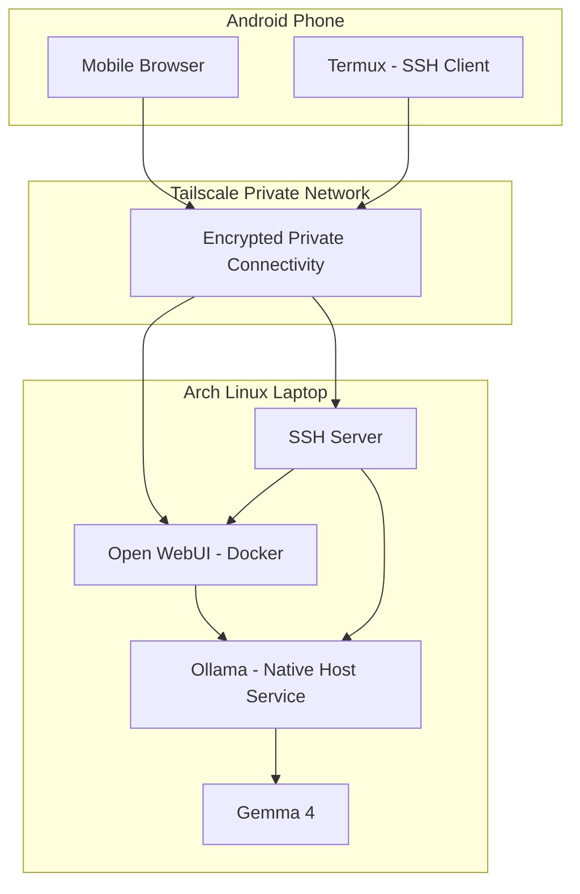

# Architecture

This document describes the architecture of my local AI infrastructure, its components, communication paths, and remote management workflow.

## Overview

The system consists of an Arch Linux laptop running Ollama natively, with Open WebUI deployed using Docker. Tailscale provides private connectivity between the laptop and my phone.

The phone serves two purposes:

1. Accessing the AI chat interface through a browser.
2. Remotely administering the laptop through SSH using Termux.

## System Architecture

## Components

### 1. Arch Linux

The laptop acts as the host machine for the AI infrastructure.

It runs Ollama natively and hosts the Open WebUI Docker container. It also provides SSH access for remote administration.

The laptop must remain powered on and connected to the internet for remote access and AI services to be available.

### 2. Ollama

Ollama is installed directly on the host operating system rather than inside Docker.

It is responsible for:

- Loading the model.
- Processing prompts.
- Generating responses.
- Providing the inference interface used by Open WebUI.

Ollama runs Gemma 4 locally, allowing inference without sending prompts to an external model API.

### 3. Gemma 4

Gemma 4 is the model used for local inference.

Ollama manages the model runtime and interacts with the host's available hardware to generate responses.

The performance of inference depends on the model variant, available memory, hardware, and workload.

### 4. Open WebUI

Open WebUI runs inside a Docker container.

It provides the browser-based interface for interacting with the locally hosted model.

Responsibilities include:

- Chat interface.
- Sending prompts to the configured LLM backend.
- Displaying model responses.
- Managing chat sessions and interface functionality.

Open WebUI communicates with Ollama through the configured connection to the host's Ollama service.

### 5. Docker

Docker is used to run Open WebUI independently of the host's main operating system environment.

It provides:

- Containerized application deployment.
- Isolation of the web interface's runtime environment.
- Easier service lifecycle management.
- Reproducible deployment configuration.

Ollama remains a native host service in this architecture.

### 6. Tailscale

Tailscale provides private connectivity between the laptop and the phone.

Both devices are connected to the same Tailscale network, allowing the phone to access services on the laptop without requiring conventional router port forwarding.

Tailscale is used for:

- Private access to Open WebUI.
- SSH connectivity to the laptop.
- Remote management when the devices are on different networks.

### 7. Termux and SSH

Termux provides a terminal environment on Android.

SSH is used to remotely connect to the Arch Linux laptop through its Tailscale network address.

From the phone, I can:

- Log into the laptop.
- Start AI-related services.
- Manage Docker containers.
- Check service status.
- Execute commands on the host.

This means the laptop does not need to be physically accessed every time the AI services need to be started or managed.

## Communication Flow

### AI Chat Flow

1. The phone opens the Open WebUI address in a browser.
2. The browser connects to the laptop through Tailscale.
3. Open WebUI processes the chat request.
4. Open WebUI sends the request to Ollama.
5. Ollama processes the request using Gemma 4.
6. Ollama returns the generated response.
7. Open WebUI displays the response in the browser.

### Remote Management Flow

1. Tailscale is running on both the phone and laptop.
2. The user opens Termux on the phone.
3. An SSH connection is established to the laptop using its Tailscale IP.
4. Commands are executed remotely on the Arch Linux host.
5. The user starts or manages the AI services as required.

## Operational Requirements

The laptop must:

- Remain powered on.
- Have internet connectivity.
- Have Tailscale running.
- Have SSH available for remote administration when needed.
- Have Ollama and Docker installed.

The AI services do not necessarily need to be running continuously. They can be started remotely through SSH when required.

## Network and Security Considerations

- Remote access is provided through Tailscale rather than public port forwarding.
- SSH is used for remote administration.
- The AI interface is accessed through the private network.
- Tailscale authentication and device access controls govern connectivity to the tailnet.

Tailscale provides a private network, but it does not automatically secure every service on that network. SSH authentication, access permissions, service configuration, and firewall rules still matter.

## Design Decisions

| Decision | Reason |
|---|---|
| Ollama runs natively | Direct access to the host environment and hardware |
| Open WebUI runs in Docker | Containerized web interface |
| Tailscale for remote access | Private connectivity without conventional port forwarding |
| SSH for administration | Remote command execution and service management |
| Termux on Android | Mobile-based remote administration |
| Local inference | Run the model on personally managed hardware |

## Limitations

- AI availability depends on the laptop being powered on.
- Inference performance depends on available hardware and memory.
- Internet connectivity is needed for remote connectivity through Tailscale and for any model or service operations that require the internet, although local inference itself does not inherently require internet access once the model is available.
- Remote access depends on Tailscale connectivity and its configuration.
- This is a personal self-hosted setup, not a highly available production infrastructure.

---

This architecture is intended for personal experimentation with local AI, Linux administration, Docker, private networking, and remote service management.
