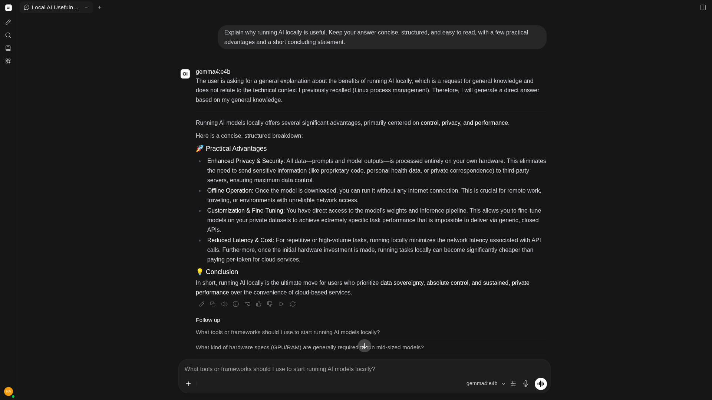
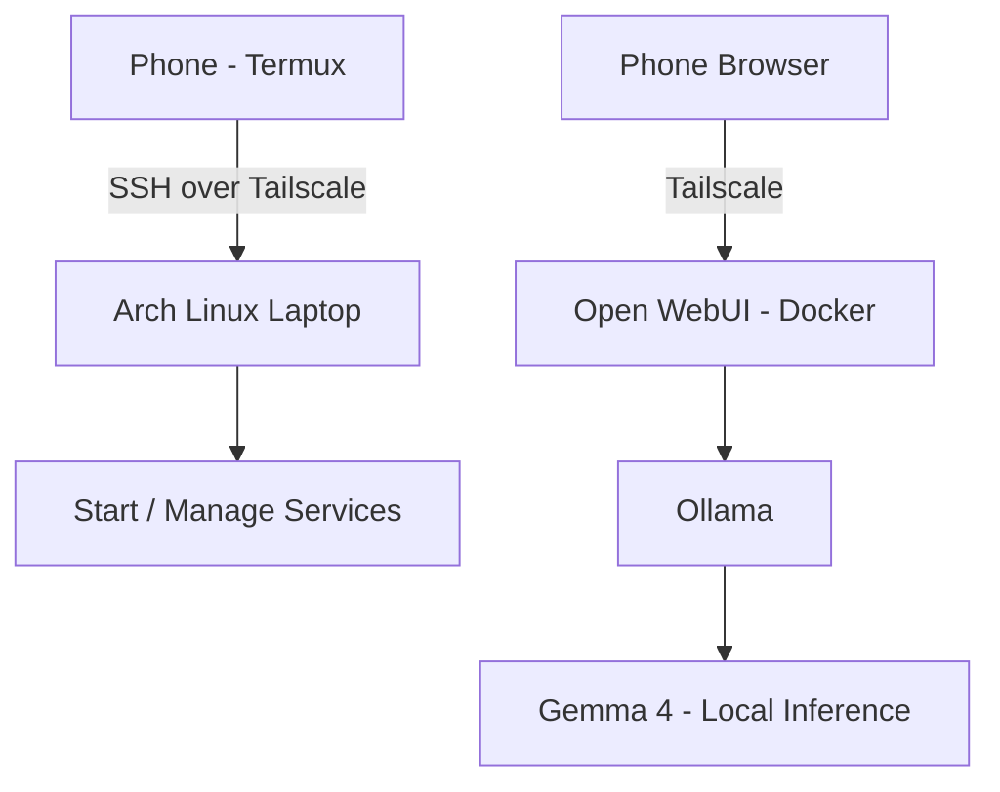

# Local AI Infrastructure

## Preview

A self-hosted AI environment running Gemma 4 locally on an Arch Linux laptop using Ollama, Open WebUI in Docker, and Tailscale for private remote access.

The setup allows me to use my local AI model from my phone, remotely manage the laptop through SSH using Termux, and operate the services without requiring physical access to the machine.

## Architecture

## Stack

| Component | Technology |
|---|---|
| Host OS | Arch Linux |
| LLM Runtime | Ollama |
| Model | Gemma 4 |
| Web Interface | Open WebUI |
| Containerization | Docker |
| Private Networking | Tailscale |
| Remote Administration | SSH |
| Mobile SSH Client | Termux |

## Features

- **Local inference:** Run Gemma 4 locally using Ollama.
- **Self-hosted interface:** Interact with the model through Open WebUI.
- **Containerized deployment:** Open WebUI runs inside Docker.
- **Remote access:** Access the web interface from a phone over Tailscale.
- **Remote administration:** Connect to the laptop using SSH through Termux.
- **Remote service management:** Start and manage the AI services from a phone.
- **Private connectivity:** Use Tailscale instead of exposing the services through public port forwarding.

## How It Works

Ollama runs on the Arch Linux host and handles model inference. Open WebUI runs in a Docker container and provides the browser-based interface for interacting with the model.

Tailscale connects the laptop and phone through a private network. This allows the phone to access Open WebUI and connect to the laptop over SSH.

The laptop does not need to be physically accessed to start the AI services. As long as it is powered on, connected to the internet, and Tailscale is running, I can remotely connect through SSH using Termux and start or manage the services.

## Access

### Web Interface

From a device connected to the same Tailscale network:

\`\`\`text
http://<laptop-tailscale-ip>:3000
\`\`\`

### Remote Administration

Connect from Termux using SSH:

\`\`\`bash
ssh <username>@<laptop-tailscale-ip>
\`\`\`

Once connected, services can be started or managed through the terminal.

## Tools Used

- [Ollama](https://ollama.com/) — Local LLM runtime.
- [Gemma](https://ai.google.dev/gemma) — Language model family.
- [Open WebUI](https://openwebui.com/) — Self-hosted AI interface.
- [Docker](https://www.docker.com/) — Containerization.
- [Tailscale](https://tailscale.com/) — Private mesh networking.
- [Termux](https://termux.dev/) — Android terminal and SSH client.
- [Arch Linux](https://archlinux.org/) — Host operating system.

## Skills Demonstrated

- Linux system administration
- SSH-based remote administration
- Docker container management
- Local LLM deployment
- Self-hosted service management
- Private networking with Tailscale
- Remote access and service management from Android
- Integration of locally hosted AI runtimes with web interfaces

## Documentation

- [Architecture](ARCHITECTURE.md) — System components, communication flow, and remote management.

---

A personal self-hosted AI infrastructure experiment combining local inference, Linux administration, containerization, and private remote connectivity.
